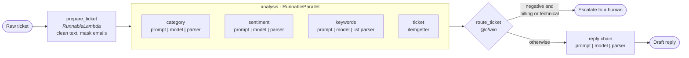
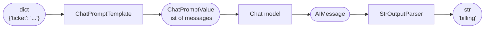

<picture>
  <source media="(prefers-color-scheme: dark)" srcset=".github/images/langchain-logo-dark.svg">
  
</picture>

# Ticket Triage with LangChain

[](https://python.langchain.com)
[](https://www.python.org)

[](LICENSE)

A support ticket triage pipeline built with LangChain Expression Language (LCEL). Given a customer message, it returns a category, sentiment, keywords, an escalation decision and a draft reply.

- [`triage/chains.py`](triage/chains.py) has the full pipeline.
- [`examples/`](examples) has one short, runnable script per LCEL pattern, all using the same tickets and prompts.

## How the pipeline works



Every box is a Runnable, so the whole pipeline supports `invoke`, `batch`, `stream` and `get_graph()` like any single step.

## Sample output

The five sample tickets in [`triage/data.py`](triage/data.py), run through the pipeline with the offline model:

| Ticket | Category | Sentiment | Keywords | Action |
|---|---|---|---|---|
| I was charged twice for my subscription on 2026-11-03… | billing | negative | charged, twice, subscription | 🚨 escalate |
| The mobile app keeps crashing when I open the reports tab. | technical | neutral | mobile, crashing, reports | ✉️ auto reply |
| Thanks for the great service! How do I change the email… | account | positive | thanks, great, service | ✉️ auto reply |
| Do you offer a student discount? | other | neutral | student, discount | ✉️ auto reply |
| The export feature is broken again and I am really frustrated… | technical | negative | export, feature, broken | 🚨 escalate |

## Setup

```bash
python3 -m venv .venv
source .venv/bin/activate
pip install -e ".[dev]"
```

```bash
python examples/chain_decorator.py
```

```bash
pytest
```

## Running without an API key

By default, everything runs on [`FakeTriageChatModel`](triage/fake_model.py), so no key or network is needed. It's a real `BaseChatModel`, so invoke, batch, streaming, pipes and graphs are all LangChain's own code. Only the answers are made up, using simple keyword rules.

To use OpenAI, copy `.env.example` to `.env`, then set:

```
LLM_PROVIDER=openai
OPENAI_API_KEY=...
OPENAI_MODEL=gpt-4o-mini
```

All model creation goes through `get_model()` in [`triage/model.py`](triage/model.py), so another provider only needs a new branch there. The OpenAI path hasn't been run against the live API, so `OPENAI_MODEL` may need updating.

## Anatomy of a chain

What each step of `prompt | model | parser` receives and returns. Rounded boxes are data, square boxes are Runnables.



## Examples

Listed from simplest to most composed.

| Script | Shows |
|---|---|
| [`model_inputs.py`](examples/model_inputs.py) | Model parameters, messages, chat and few-shot prompts |
| [`output_parsers.py`](examples/output_parsers.py) | String, list and custom parsers |
| [`basic_chain.py`](examples/basic_chain.py) | `prompt \| model \| parser` |
| [`batch.py`](examples/batch.py) | `batch` and `max_concurrency` |
| [`streaming.py`](examples/streaming.py) | `stream` |
| [`runnable_sequence.py`](examples/runnable_sequence.py) | `Runnable` and `RunnableSequence` |
| [`passthrough_assign.py`](examples/passthrough_assign.py) | `RunnablePassthrough` and `.assign` |
| [`graph.py`](examples/graph.py) | `get_graph()`, ASCII and Mermaid |
| [`parallel.py`](examples/parallel.py) | `RunnableParallel` |
| [`parallel_into_chain.py`](examples/parallel_into_chain.py) | Piping a parallel step onward, dict shorthand |
| [`runnable_lambda.py`](examples/runnable_lambda.py) | `RunnableLambda` |
| [`chain_decorator.py`](examples/chain_decorator.py) | `@chain` and the full pipeline |

## LCEL cheat sheet

| I want to | Use |
|---|---|
| Connect steps | `prompt \| model \| StrOutputParser()` |
| Run on one input | `chain.invoke(input)` |
| Run on many inputs | `chain.batch(inputs, config={"max_concurrency": 5})` |
| Get output as it's generated | `for chunk in chain.stream(input): ...` |
| Inspect a chain | `chain.steps`, `chain.get_graph().print_ascii()` |
| Add a key and keep the rest | `RunnablePassthrough.assign(new_key=other_chain)` |
| Run branches at the same time | `RunnableParallel(a=chain_a, b=chain_b)` or `{"a": chain_a, "b": chain_b}` in a pipe |
| Pick one key from a dict | `itemgetter("key")` |
| Use a function as a step | `RunnableLambda(fn)`, or just `step \| fn` |
| Use a function with branching logic | `@chain` |

Streaming stops being incremental at a `RunnableLambda`, which waits for its whole input unless it's written as a generator.

## Notes on LangChain 1.x

Written against LangChain 1.7. Older examples online may differ:

- Imports come from `langchain_core` and `langchain_openai`.
- Use `prompt | model | parser` instead of `LLMChain`.
- `DatetimeOutputParser` isn't in `langchain-core`, so [`triage/parsers.py`](triage/parsers.py) has a small custom parser instead.

## License

[MIT](LICENSE)

The LangChain logo in [`.github/images`](.github/images) is a trademark of LangChain, Inc. It comes from [Wikimedia Commons](https://commons.wikimedia.org/wiki/File:LangChain_Logo.svg), where it is published under the MIT license, and is used here only to show the project is built with LangChain.
